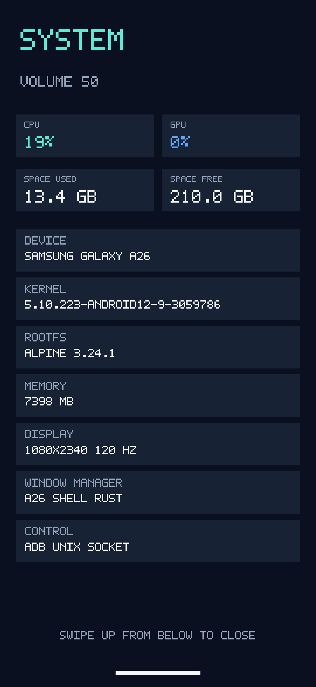

# a26-system

`a26-system` is a standalone Rust/X11 application containing the System scene
from the A26 shell. It creates a conventional, window-manager-controlled
1080x2340 window named `a26-system`; it is deliberately **not** an
override-redirect window.



Companion window manager: <https://github.com/Yeyito777/a26-shell>

The view keeps the original navy, mint, blue, and white card layout and shows:

- aggregate CPU utilization calculated from consecutive `/proc/stat` samples;
- Samsung Mali utilization from
  `/sys/class/misc/mali0/device/utilization`;
- root-filesystem used and available space from `statvfs(3)`;
- device, kernel, Alpine release, total memory, display, window-manager, and
  control cards; and
- the bottom close instruction and gesture indicator.

Telemetry and the displayed logical volume are refreshed once per second. The
volume is read by connecting to `/run/a26-shell/control.sock`, sending
`state\n`, and parsing the shell's JSON response. It is rendered as `--` when
the socket cannot be reached, times out, or returns an invalid response.

The program has no touch or navigation handling. The window manager is
expected to own the global bottom-edge swipe and terminate this process when
the user closes the app.

## Repository layout

```text
assets/                     System icon source and generated BGRX pixels
scripts/prepare-assets.py   deterministic PNG-to-BGRX conversion
scripts/check.sh            host format, test, clippy, and debug-build checks
scripts/build.sh            checked static aarch64 musl release build
scripts/install.sh          build and ADB installation
src/                        X11 client, renderer, telemetry, IPC, and font
docs/system-view.png        capture of the separately managed app on-device
```

`assets/system-app.bgrx` is exactly 220x220 pixels, four bytes per pixel in
B,G,R,X byte order. It is committed so the launcher can consume it directly.
The PNG is the editable/source asset.

## Host prerequisites

- Rust with `rustup`
- `aarch64-linux-musl-gcc`
- Python 3 with the Pillow version pinned in `requirements-assets.txt`
- ADB, only for installation
- `readelf` (normally supplied by binutils) for the static-link check

Install the pinned asset dependency in an isolated environment if desired:

```sh
python3 -m pip install -r requirements-assets.txt
```

Run all native host checks:

```sh
scripts/check.sh
```

Create the static target build:

```sh
scripts/build.sh
```

The resulting untracked executable is
`target/aarch64-unknown-linux-musl/release/a26-system`. The build script adds
the Rust target when necessary and rejects an ELF containing a dynamic program
interpreter.

## Installation

```sh
scripts/install.sh
```

When `A26_SERIAL` is unset, the installer proceeds only when `adb devices`
reports exactly one authorized device. Set `A26_SERIAL` to select a device
explicitly. The script selects the device, builds, stages files through the
device's local temporary directory, installs them atomically, verifies SHA-256
hashes, and removes its staging files.

Within the Linux root filesystem rooted at `/data/local/a26-linux`, it installs:

- `/opt/a26-system/bin/a26-system`
- `/opt/a26-system/share/system-app.bgrx`

Running the installer is the only repository workflow that contacts a device.

## Runtime and integration assumptions

- The executable runs in the intended Alpine root filesystem/mount namespace,
  with `/proc` and `/sys` mounted and the shell's `/run` directory visible. This
  makes `/`, `/etc/alpine-release`, and the telemetry paths describe the Linux
  environment rather than the Android host.
- An X11 server is available through `DISPLAY` and has a 24-bit-compatible
  true-color visual, as in the target environment.
- The window manager honors or enforces the requested 1080x2340 fullscreen
  geometry. The client also publishes the standard EWMH fullscreen state and
  redraws after configure/expose events.
- The launcher starts the binary with permission to read the root-only shell
  control socket. Running it without that permission is safe; only the volume
  field becomes unavailable.
- The shell's `state` response remains a newline-terminated JSON envelope with
  a numeric `result.volume` between 0 and 100.
- The window manager retains the global bottom-swipe gesture, kills or closes
  `a26-system`, and then reveals the launcher. No such policy is implemented
  by this client.
- Launcher integration can use the installed BGRX icon directly; the app does
  not load the icon while rendering the System scene.

No service definition or window-manager configuration is installed by this
repository. Integration policy remains the responsibility of the surrounding
phone shell.

## License

MIT. See [LICENSE](LICENSE).
