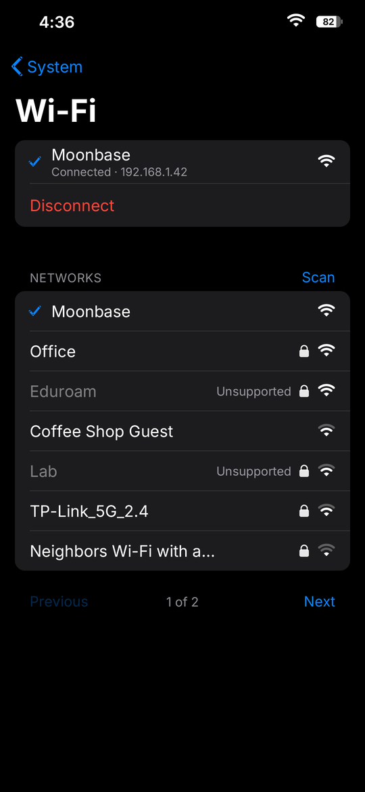
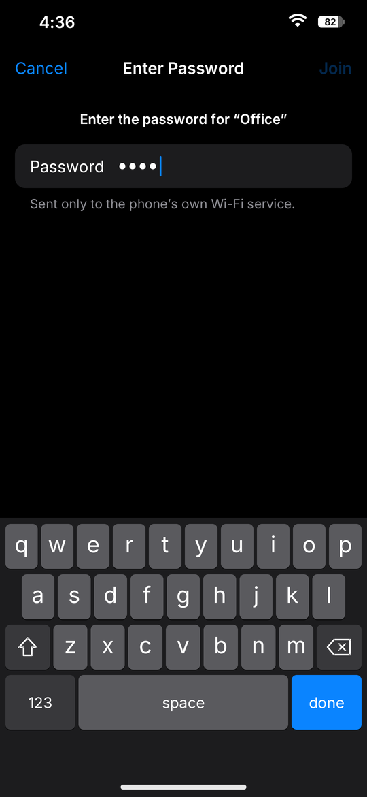

# a26-system

`a26-system` is a standalone Rust/X11 application containing the System scene
from the A26 shell plus a touch-first Wi-Fi configuration view. It creates a
conventional, window-manager-controlled 1080x2340 window named `a26-system`; it
is deliberately **not** an override-redirect window.

<p>
  
  
  
</p>

Companion window manager: Moon, in <https://github.com/Yeyito777/OSS-Phone-V1>

The interface follows the iOS Settings app in dark appearance, sharing Moon's
palette, anti-aliased renderer (`gfx.rs`, `present.rs`, `text.rs`, vendored
from Moon), and the Inter typeface (SIL OFL 1.1, `assets/fonts/OFL.txt`). The
System page shows:

- Wi-Fi (the current network; tap to open the Wi-Fi page) and the shell volume;
- aggregate CPU utilization calculated from consecutive `/proc/stat` samples
  and Samsung Mali utilization from
  `/sys/class/misc/mali0/device/utilization`, as meters;
- root-filesystem used and available space from `statvfs(3)`, as a bar; and
- device, software, kernel, total memory, and display rows.

The Wi-Fi page, pushed with a "‹ System" back button, shows the current link
with its IP address and a Disconnect row, a Scan control, inline status, and
seven-row scan pages with lock and signal glyphs and whole-row SSID targets.
Protected networks open a password page. The app asks Moon for its system
keyboard (`keyboard show password` on Moon's control socket) and decodes the
resulting XTEST key presses on its own window; Return joins. If Moon refuses,
an in-app keyboard is shown instead. The entry accepts WPA Personal
passphrases of 8-63 printable ASCII bytes or a 64-digit hexadecimal key.

Telemetry and the displayed logical volume are refreshed once per second. The
volume is read by connecting to `/run/a26-shell/control.sock`, sending
`state\n`, and parsing the shell's JSON response. It is rendered as `--` when
the socket cannot be reached, times out, or returns an invalid response.

The event loop blocks in `poll(2)` on the X connection until input, the next
one-second refresh, or (only while Wi-Fi work is in flight) a 125 ms tick.

Core X11 pointer events, including touch-to-pointer emulation, drive only
tap-sized controls. A 32-pixel movement cancels a tap, and the bottom 170 pixels
never produce an app action. The app does not recognize, grab, or close on
swipes. A26 Shell remains the owner of the global bottom-edge swipe and
terminates this process when the user closes the app.

Wi-Fi I/O uses the root-only protocol in
[`docs/wifi-backend-protocol.md`](docs/wifi-backend-protocol.md). The UI only
talks to `/run/a26-wifi/control.sock` from a worker thread; the separately built
`a26-wifi-service` owns `wpa_supplicant`, DHCP, Android's per-interface policy
routing table, DNS, scanning, and the root-only saved-network store. The UI
safely renders the service as unavailable when the backend is stopped.

## Repository layout

```text
assets/                     System icon source and generated BGRX pixels
scripts/prepare-assets.py   deterministic PNG-to-BGRX conversion
scripts/check.sh            host format, test, clippy, and debug-build checks
scripts/build.sh            checked static aarch64 musl release build
scripts/install.sh          build, pinned package, and ADB installation
scripts/integrate-native-session.sh  idempotent device-local lifecycle hooks
scripts/wifi-start.sh        start the native Wi-Fi supervisor over root ADB
scripts/wifi-stop.sh         stop native Wi-Fi before restoring Android
scripts/phone/               DHCP routing/DNS and offline package installers
src/                        X11 UI, Wi-Fi backend, telemetry, controls, and font
wifi-packages/               pinned Alpine package sources and SHA-256 manifest
docs/system-view.png        capture of the separately managed app on-device
docs/wifi-backend-protocol.md  root-only backend contract and secret rules
```

`assets/system-app.bgrx` is exactly 220x220 pixels, four bytes per pixel in
B,G,R,X byte order. It is committed so the launcher can consume it directly.
The PNG is the editable/source asset.

## Host prerequisites

- Rust with `rustup`
- `aarch64-linux-musl-gcc`
- Python 3 with the Pillow version pinned in `requirements-assets.txt`
- ADB, only for installation and lifecycle control
- `curl` for the pinned Alpine Wi-Fi packages
- `readelf` (normally supplied by binutils) for the static-link check

Install the pinned asset dependency in an isolated environment if desired:

```sh
python3 -m pip install -r requirements-assets.txt
```

Run all native host checks:

```sh
scripts/check.sh
```

The deterministic unit suite covers touch/drag discrimination, reserved shell
gesture space, hit targets, keyboard modes, password validation/redaction,
scan sorting/de-duplication/paging, model transitions, protocol bounds and
error mapping, and exact Unix-socket request/response behavior.

Create the static target build:

```sh
scripts/build.sh
```

The resulting untracked executables are `a26-system`, `a26-wifi-service`,
`a26-wifi-ctl`, and `a26-systemctl` under
`target/aarch64-unknown-linux-musl/release/`. The build script adds the Rust
target when necessary and rejects an ELF containing a dynamic program
interpreter.

## Installation

```sh
scripts/install.sh
```

When `A26_SERIAL` is unset, the installer proceeds only when `adb devices`
reports exactly one authorized device. Set `A26_SERIAL` to select a device
explicitly. The script selects the device, builds, stages files through the
device's local temporary directory, installs them atomically, verifies SHA-256
hashes, and removes its staging files.

Within the Linux root filesystem rooted at `/data/local/a26-linux`, it installs:

- `/opt/a26-system/bin/a26-system`
- `/opt/a26-system/bin/a26-wifi-service`
- `/opt/a26-system/bin/a26-wifi-ctl`
- `/opt/a26-system/bin/a26-systemctl`
- `/opt/a26-system/libexec/a26-udhcpc.script`
- `/opt/a26-system/libexec/a26-wifi-start`
- `/opt/a26-system/libexec/a26-wifi-stop`
- `/opt/a26-system/share/system-app.bgrx`

It also installs the pinned Alpine 3.24 `wpa_supplicant`, `iw`, and required
libraries from verified APKs. Installation does **not** activate or restart the
backend. Instead, the idempotent integration step starts native Wi-Fi only from
the already-suspended Xorg session and stops it device-locally before Android's
graphics and Java framework are resumed. `scripts/wifi-start.sh` and
`scripts/wifi-stop.sh` remain explicit host-side diagnostic controls.

## Runtime and integration assumptions

- The executable runs in the intended Alpine root filesystem/mount namespace,
  with `/proc` and `/sys` mounted and the shell's `/run` directory visible. This
  makes `/`, `/etc/alpine-release`, and the telemetry paths describe the Linux
  environment rather than the Android host.
- An X11 server is available through `DISPLAY` and has a 24-bit-compatible
  true-color visual, as in the target environment.
- The window manager honors or enforces the requested 1080x2340 fullscreen
  geometry. The client also publishes the standard EWMH fullscreen state and
  redraws after configure/expose events.
- The launcher starts the binary with permission to read the root-only shell
  control socket. Running it without that permission is safe; only the volume
  field becomes unavailable.
- The shell's `state` response remains a newline-terminated JSON envelope with
  a numeric `result.volume` between 0 and 100.
- The window manager retains the global bottom-swipe gesture, kills or closes
  `a26-system`, and then reveals the launcher. No such policy is implemented
  by this client.
- `a26-wifi-service` exposes `/run/a26-wifi/control.sock` according to the
  documented version-1 protocol. The directory is root-owned mode `0700`, the
  socket root-owned mode `0600`, and the service enforces UID 0 with
  `SO_PEERCRED`. Without it, metrics and volume continue to work and the Wi-Fi
  view reports that the service is unavailable.
- Passwords are accepted only through the on-screen keyboard. They are never
  accepted through argv or environment variables, never logged or returned by
  status, always masked on screen, serialized directly to the local socket,
  and held in zeroizing buffers. For WPA2 Personal, the backend derives the
  256-bit PSK into a tmpfs-backed supplicant configuration and, only after
  association to the exact requested SSID succeeds, atomically persists that derived key in
  `/var/lib/a26-wifi/networks.json`, owned by root with mode `0600`; it never
  persists the original passphrase. WPA3-SAE and enterprise authentication are
  intentionally rejected by the initial backend rather than handled unsafely.
- Launcher integration can use the installed BGRX icon directly; the app does
  not load the icon while rendering the System scene.

The service derives Android's Wi-Fi policy table as `1000 + wlan0 ifindex`,
keeps a foreground renewing `udhcpc` child, installs a native-session-only
priority-`10550` lookup rule for root-run Linux clients, writes DNS directly
into the rootfs-mounted resolver file, and owns its exact supplicant and DHCP PIDs. The
native-session cleanup runs both from the Xorg supervisor and from Android's
restore script, removing addresses, routes, neighbors, runtime sockets, and
owned processes before Android Wi-Fi is allowed to return.

## License

MIT. See [LICENSE](LICENSE).
